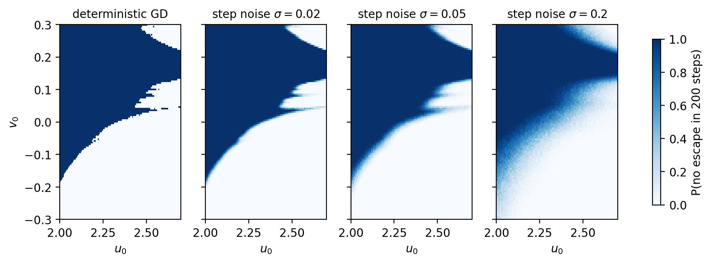

# Noise and the fractal convergence boundary of gradient descent

Numerical experiments extending Liang & Montúfar, *Gradient Descent with Large Step Sizes: Chaos and Fractal Convergence Region* (ICLR 2026, [arXiv:2509.25351](https://arxiv.org/abs/2509.25351)).

**Question.** For gradient descent with near-critical step size on regularized scalar factorization, the set of initializations that converge has a fractal boundary. Does a small amount of noise preserve that boundary, blur it, or change it, and how does the effect scale with the noise level?

**Short answer.** Noise blurs the boundary into a band of uncertain outcomes whose area grows as a power law in the noise level, while the location of the boundary barely moves. The power-law exponents are of the same order as the uncertainty exponent 2 − D of the deterministic boundary (D ≈ 1.26, consistent with the 1.249 reported in the paper) but mostly larger.

Report: [`report/Noise_and_the_fractal_convergence_boundary.pdf`](report/Noise_and_the_fractal_convergence_boundary.pdf)



## Setup

- Loss `L(u, v) = ½(uv − y)² + ½λ(u² + v²)` with `y = 0.5`, `λ = 0.2`, step size `η = 1` (the setting of Figure 3 in the paper).
- **Step noise:** `η_t = η(1 + σ ξ_t)`, `ξ_t ~ U(−1, 1)`, applied to the full gradient.
- **Additive noise:** gradient `∇L + σ Z_t`, `Z_t ~ N(0, I)` (a stylized proxy for SGD).
- A trajectory **escapes** if `|u|` or `|v|` exceeds `1e8` within 200 steps.

## Method

With noise, an initialization has a *probability* of not escaping. A single noisy run per pixel with independent noise produces speckle that looks like a rougher boundary but is sampling noise (see `results/fig_coupling.png`). Instead, following the probability-basin approach of Nieto, Seoane & Sanjuán (2021), the survival probability is estimated from 128 independent runs per initialization, and the uncertain fraction `0.1 < p < 0.9` is fitted as `σ^β`. For deterministic GD the uncertainty exponent of Grebogi, McDonald, Ott & Yorke (1983) gives the box-counting dimension of the boundary via `f(ε) ~ ε^(2 − D)`.

## Results

Windows near the boundary: W1 = [2, 2.7] × [−0.3, 0.3], W2 = [1.7, 2.3] × [0.5, 1.1]; 121 × 121 grids, 128 runs per point.

| Window | β, step noise | β, additive noise | 2 − D (deterministic) | D |
|---|---|---|---|---|
| W1 | 0.86 ± 0.01 | 0.84 ± 0.02 | 0.74 ± 0.01 | 1.26 |
| W2 | 0.73 ± 0.01 | 0.83 ± 0.01 | 0.74 ± 0.01 | 1.26 |

- The p = ½ contour differs from the deterministic boundary on 0.1–3.7% of each window; total survival changes by less than 0.014.
- Fine filaments are washed out first: at moderate σ the p = ½ contour is 20–35% smoother than the deterministic boundary.
- The uncertain fraction is stable under 2× grid refinement (0.134 vs 0.135 at σ = 0.1) and under doubling the horizon (0.136).


## Reproduce

```bash
pip install -r requirements.txt
python src/test_dynamics.py      # correctness checks
python src/run_all.py            # all numbers and figures (~15 min)
QUICK=1 python src/run_all.py    # small smoke test (~2 min)
```

Outputs go to `results/` (`results.json` plus figures).

## Layout

```
src/dynamics.py       GD with noise, vectorized over initial conditions and runs
src/metrics.py        uncertain fraction, interface measures, power-law fits
src/figures.py        figures
src/run_all.py        baseline, noise sweep, uncertainty exponent, controls
src/test_dynamics.py  gradient vs finite differences, fixed points, projected map, symmetry, reproducibility
results/              results.json and figures
report/               short written report
```

## Limitations

- Survival within a finite horizon is not asymptotic convergence; only escape vs. survival is analysed, not which minimizer is selected.
- Two local windows; band thresholds 0.1/0.9 are a choice; 128 runs per point.
- Additive Gaussian noise is a stand-in for SGD; minibatch noise and matrix factorization are not yet tested.

An earlier version of this repository (see commit history) measured box-counting dimension on single noise realizations. That analysis confused sampling speckle with geometry and is superseded by the probability-based analysis here.

## References

1. S. Liang, G. Montúfar. Gradient descent with large step sizes: chaos and fractal convergence region. ICLR 2026. arXiv:2509.25351.
2. C. Grebogi, S. W. McDonald, E. Ott, J. A. Yorke. Final state sensitivity: an obstruction to predictability. Phys. Lett. A 99 (1983) 415–418.
3. A. R. Nieto, J. M. Seoane, M. A. F. Sanjuán. Final state sensitivity in noisy chaotic scattering. Chaos, Solitons & Fractals 150 (2021) 111181.
4. J. Sohl-Dickstein. The boundary of neural network trainability is fractal. arXiv:2402.06184 (2024).
