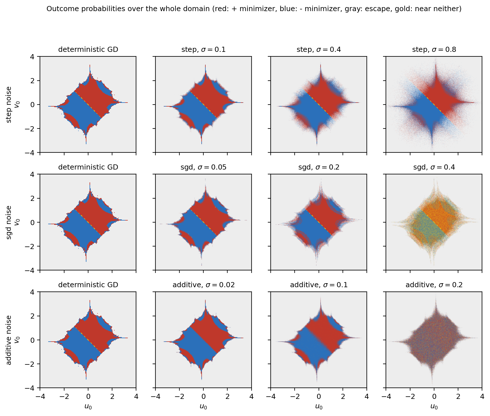
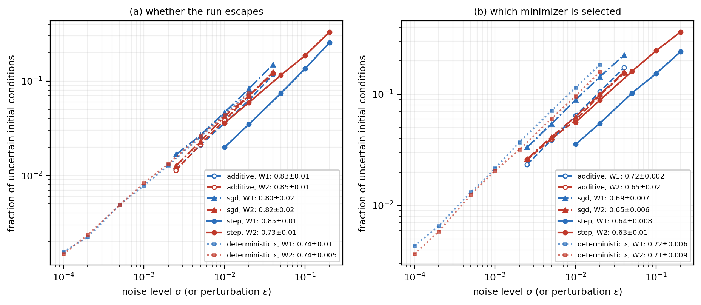

# Noise and the fractal convergence boundary of gradient descent

Numerical experiments extending Liang & Montúfar, *Gradient Descent with Large Step Sizes: Chaos and Fractal Convergence Region* (ICLR 2026, [arXiv:2509.25351](https://arxiv.org/abs/2509.25351)).

**Question.** Gradient descent with near-critical step size on regularized scalar factorization has a fractal convergence boundary. Does a small amount of noise preserve that boundary, blur it, or change it qualitatively, and what happens as the noise is increased further?

**Summary.**
- The deterministic results of the paper are recovered: the convergence region of Figure 3, the box-counting dimension **1.249** of the projected boundary, and the critical step size of Theorem 1.
- Small noise **blurs** the boundary into a band of uncertain outcomes whose area grows as a **power law** in the noise level, while the location of the boundary barely moves.
- Noise affects **which minimizer is selected** more strongly than **whether GD converges**.
- Larger noise changes the picture qualitatively, differently for each noise model: random step sizes enlarge the convergence region, SGD loses its minimizers beyond σ = y − λ, and isotropic noise randomizes the selected minimizer.

Report: [`report/Noise_and_the_fractal_convergence_boundary.pdf`](report/Noise_and_the_fractal_convergence_boundary.pdf)



## Setup

- Loss `L(u, v) = ½(uv − y)² + ½λ(u² + v²)` with `y = 0.5`, `λ = 0.2`, step size `η = 1` (the setting of Figure 3 in the paper).
- **Step noise:** random step size `η_t = η(1 + σ ξ_t)`, `ξ_t ~ U(−1, 1)`; the minimizers stay fixed points.
- **SGD:** batch-size-one SGD on the finite sum over two data points `y ± σ`; same minimizers as the deterministic loss, state-dependent gradient noise.
- **Additive noise:** isotropic Gaussian gradient noise with standard deviation `σ`.
- A run **escapes** if `|u|` or `|v|` exceeds `1e8` within 200 steps.

## Method (following the steps suggested by G. Montúfar)

1. **Recover the deterministic phenomenon** (`src/exp_reproduce.py`): the convergence region, the box-counting dimension of the projected boundary using the planar map of Proposition 3, the critical step size of Theorem 1, and the uncertainty exponent of Grebogi, McDonald, Ott & Yorke (1983) as an independent estimate of the dimension.
2. **Introduce noise gradually near the boundary** (`src/exp_windows.py`): outcome probabilities from 96 independent runs per initialization on 101 × 101 grids in two windows, W1 = [2, 2.7] × [−0.3, 0.3] and W2 = [1.7, 2.3] × [0.5, 1.1], following the probability-basin approach of Nieto, Seoane & Sanjuán (2021). Measured: the fraction with uncertain escape (0.1 < P(no escape) < 0.9) and the fraction with uncertain minimizer selection.
3. **Increase the noise further** (`src/exp_global.py`): the whole domain [−4, 4]², 161 × 161 grid, 32 runs per initialization.
4. **Controls** (`src/exp_controls.py`): grid resolution, horizon, and shared versus independent noise. A single noisy run per pixel with independent noise produces speckle that looks like a rougher boundary but is sampling noise (`results/fig_coupling.png`).

## Results

Deterministic reproduction:

| Check | Result |
|---|---|
| Box-counting dimension of the projected boundary (paper: 1.249) | **1.249** (R² = 0.9966) |
| Theorem 1, step size 3% / 10% below the critical value | converges for 100% of 20,000 initializations |
| Theorem 1, step size 3% / 10% above the critical value | converges for 0% |
| Uncertainty exponent, convergence boundary (W1, W2) | D ≈ 1.26, 1.26 |

Exponents of the uncertain fraction versus noise level:

| | escape, W1 | escape, W2 | selection, W1 | selection, W2 |
|---|---|---|---|---|
| step noise | 0.85 ± 0.01 | 0.73 ± 0.01 | 0.64 ± 0.01 | 0.63 ± 0.01 |
| SGD | 0.80 ± 0.02 | 0.82 ± 0.02 | 0.69 ± 0.01 | 0.65 ± 0.01 |
| additive noise | 0.83 ± 0.01 | 0.85 ± 0.01 | 0.72 ± 0.002 | 0.65 ± 0.02 |
| deterministic, perturbation ε (2 − D) | 0.74 ± 0.01 | 0.74 ± 0.005 | 0.72 ± 0.01 | 0.71 ± 0.01 |

- The majority outcome differs from deterministic GD on 0.1–3.9% of each window; the probability of not escaping changes by at most 0.014.
- The uncertain escape fraction is stable under 2× grid refinement (0.134 vs 0.135) and doubling the horizon (0.136).
- Larger noise: step noise grows the non-escaping region from 20.9% to 25.1% of the domain at σ = 0.8 (all surviving runs converge exactly); SGD keeps 99.7% of surviving runs near a minimizer up to σ = 0.2 but only 57% at σ = 0.4, because for σ > y − λ = 0.3 one sample loss is minimized at the origin; isotropic noise at σ = 0.2 makes the selected minimizer uncertain over essentially the whole surviving region.



## Reproduce

```bash
pip install -r requirements.txt
python src/test_dynamics.py      # correctness checks
python src/run_all.py            # all experiments and figures
QUICK=1 python src/run_all.py    # smaller grids and fewer runs, for a quick check
```

Outputs go to `results/`. Each experiment can also be run on its own, e.g. `MODES=sgd python src/exp_windows.py`.

## Layout

```
src/dynamics.py        GD with step, SGD and additive noise, vectorized over initial conditions and runs
src/metrics.py         uncertain fractions, interfaces, erosion, box counting, power-law fits
src/config.py          grids, windows, noise levels, run counts (QUICK=1 for small settings)
src/exp_reproduce.py   step 1: deterministic reproduction
src/exp_windows.py     step 2: noise near the boundary
src/exp_global.py      step 3: larger noise over the whole domain
src/exp_controls.py    step 4: resolution, horizon and noise-coupling checks
src/figures.py         all figures
src/run_all.py         runs everything
src/test_dynamics.py   gradient vs finite differences, fixed points, projected map, SGD unbiasedness, symmetry, reproducibility, metrics
results/               JSON results, probability maps (.npz) and figures
report/                written report
```

## Limitations

- Not escaping within a finite horizon is not asymptotic convergence; under persistent noise iterates fluctuate around a minimizer.
- Two local windows; the 0.1/0.9 thresholds are a choice; 96 runs per point near the boundary and 32 over the whole domain.
- Scalar factorization (d = 1) only; matrix factorization and real minibatch training are not tested.

An earlier version of this repository (see commit history) measured box-counting dimension on single noise realizations. That analysis confused sampling speckle with geometry and is superseded by the probability-based analysis here.

## References

1. S. Liang, G. Montúfar. Gradient descent with large step sizes: chaos and fractal convergence region. ICLR 2026. arXiv:2509.25351.
2. C. Grebogi, S. W. McDonald, E. Ott, J. A. Yorke. Final state sensitivity: an obstruction to predictability. Phys. Lett. A 99 (1983) 415–418.
3. A. R. Nieto, J. M. Seoane, M. A. F. Sanjuán. Final state sensitivity in noisy chaotic scattering. Chaos, Solitons & Fractals 150 (2021) 111181.
4. J. Sohl-Dickstein. The boundary of neural network trainability is fractal. arXiv:2402.06184 (2024).
